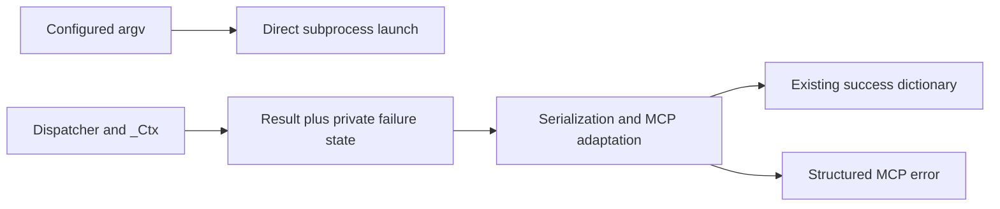

## Context

`GenericLanguageServer` converts configured argv to a string, although the supplied multilspy 0.1.1 evidence shows `ProcessLaunchInfo.cmd` reaching `create_subprocess_exec(*cmd)`. `_Ctx.note` conflates empty answers with failed execution; adapters serialize every dispatcher result as MCP success. The existing per-call deadline constructs a fresh result outside `_Ctx`.

MCP 2.3.0 evidence supports `CallToolResult` passthrough from dict-annotated adapters, exempting errors from output-model validation. This preserves successful schemas without MCP imports in dispatch/models.

## Decisions

**Launch:** pass a defensive list copy directly to `ProcessLaunchInfo`, preserving tokens, cwd and order. String joining or a shell wrapper adds interpretation incompatible with the installed interface. No launcher abstraction or dependency change is justified.

**Classification:** extend `_Ctx`, rather than introducing a parallel outcome engine, with completed-tool-answer accounting independent of payload nonemptiness. Centralize note, warnings and failure finalization there. A recorded execution failure with no completed answer yields private failure metadata; any completed answer or usable partial data permits a non-error result with partial-failure guidance. No recorded failure leaves informational outcomes non-error.

Completion is recorded at semantic boundaries, not in `_req`: an empty terminal navigation response, symbol absence/ambiguity, or empty hierarchy preparation completes an answer; successful position resolution alone does not complete rename/navigation. Nonempty hierarchy preparation alone does not rescue failed child requests; successful child answers, including empty lists, do. Successful mutations count only after edit application returns. No capability/configuration match remains informational, not evidence that an attempted operation succeeded.

Diagnostics count usable pull reports or accepted push publishes, including explicit empty lists. Missing publishes and unusable reports remain unknown-outcome hints, not failures or completed answers. Preserve diagnostic caveats alongside merged data and partial failures; an unknown report alone does not manufacture an MCP error.

**Transport boundary:** carry a private, default-false failure field on tool-result dataclasses and `_Outcome`, forwarding it through location wrappers. Exclude that field explicitly during serialization. This is smaller than a new result-envelope hierarchy; parsing note prefixes is rejected because presentation text is not machine state. Every `_Ctx`-dependent early return uses its finalizer; validation-only informational returns keep the default. Deadline results explicitly mark failure and retain the existing discard-partial policy.

One adapter helper returns the exact existing dictionary on success. On failure it returns `CallToolResult(is_error=True, structured_content=payload, content=[TextContent(type='text', text=...)])`, retaining note/warnings in both structured payload and readable error guidance. Raising exceptions is rejected because direct framework calls raise `ToolError` and lose the intended structured return path. Dict annotations retain successful output schemas.

## Risks/Trade-offs

- Classification spans early returns and multi-stage operations; dispatcher and deadline regression coverage complements adapter coverage.
- Failure metadata remains per-call; locks, retries, cooldown, cleanup, routing order and scaling stay unchanged. Recovery follows existing retry and startup bounds, without new retries.
- Edit helpers can log skipped reads or notification failures and can modify files before an exception. Protocol classification does not establish atomicity, rollback or safe automatic replay; those helpers remain unchanged.
- README, STYLE adapter/error policy and lifecycle/tool deltas align around protocol errors versus informational notes, removing shell-launch claims.
